<div align="center">

# 反焦虑决策沙盘

**把被家庭、稳定、比较缠住的决定，变成可拆解、可实验的沙盘。**

<a href="https://fuzzylogic112.github.io/anti-anxiety-sandbox/"></a>

   

<br><br>

<a href="https://fuzzylogic112.github.io/anti-anxiety-sandbox/">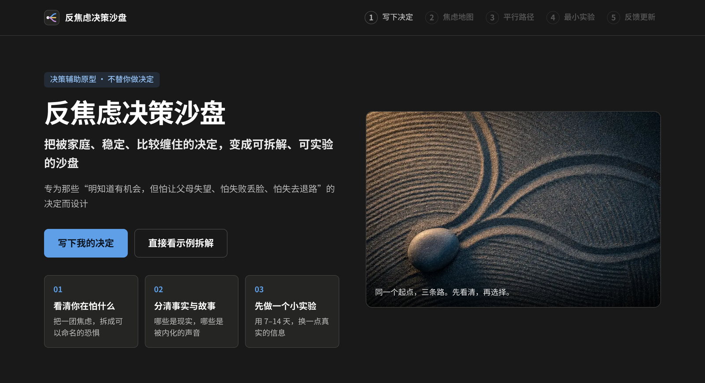</a>

</div>

## 这是什么

专为那些「明知道有机会，但怕让父母失望、怕失败丢脸、怕失去退路」的决定而设计。

它不替你做决定，而是陪你把一团焦虑拆开：你到底在怕什么、哪些是事实哪些是故事、每条路 1 年和 3 年后大概会怎样。然后先用 7–14 天的小实验换一点真实的信息，再回来更新判断。

**在线体验：** https://fuzzylogic112.github.io/anti-anxiety-sandbox/

## 五步用法

| 步骤 | 你会得到什么 |
| --- | --- |
| 1. 写下决定 | 把纠结原样写下来，点「开始拆解」，约 2 秒生成完整沙盘 |
| 2. 焦虑地图 | 焦虑强度与构成、父母反对的情绪权重、核心恐惧雷达、事实与故事、可控与不可控 |
| 3. 平行路径 | 三条路的六项指标、未来 3 年的压力与情绪曲线、关键节点、风险与后悔点，可并排对比 |
| 4. 最小实验 | 3 个 7–14 天的实验，写明成本、对父母的影响和风险等级，附安全垫计算器 |
| 5. 反馈更新 | 写下实验结果，重新评估三条路，重点说明家庭压力与风险感知的变化 |

### 1. 写下决定

不用组织语言，越具体越好：你在纠结什么、家里人怎么说、你最怕发生什么。输入时会实时识别藏在决定里的压力源（父母反对、稳定与不确定、面子、退路、财务安全垫……）。

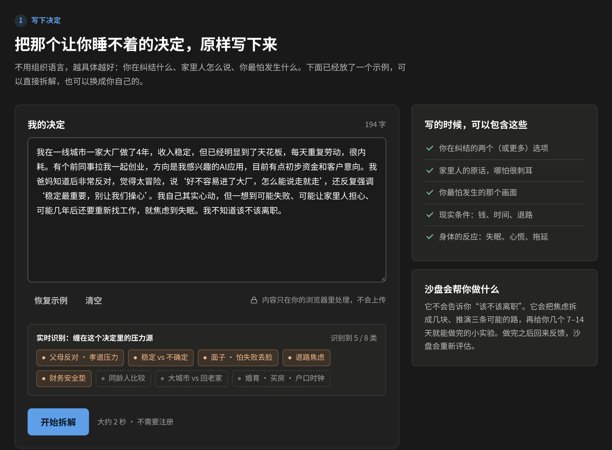

### 2. 焦虑地图

- **焦虑强度与构成**：除了分数，还拆成关系型、不确定型、身份型三类来源；底部附两条今晚就能做的小建议。
- **父母反对的情绪权重（特别标注）**：它占了焦虑的多少、由哪些担心构成。打开「如果爸妈说：你想试，就去试试吧」开关，可以直接看到焦虑会降到多少。
- **核心恐惧雷达**：六种恐惧的强度，以及每种恐惧背后在保护什么。
- **事实与故事**：把「稳定才是孝顺」这类从小听到大的道理，拆成事实成分和故事成分，并给出验证方法和对应实验。
- **可控与不可控**：把精力放回能控制的地方。

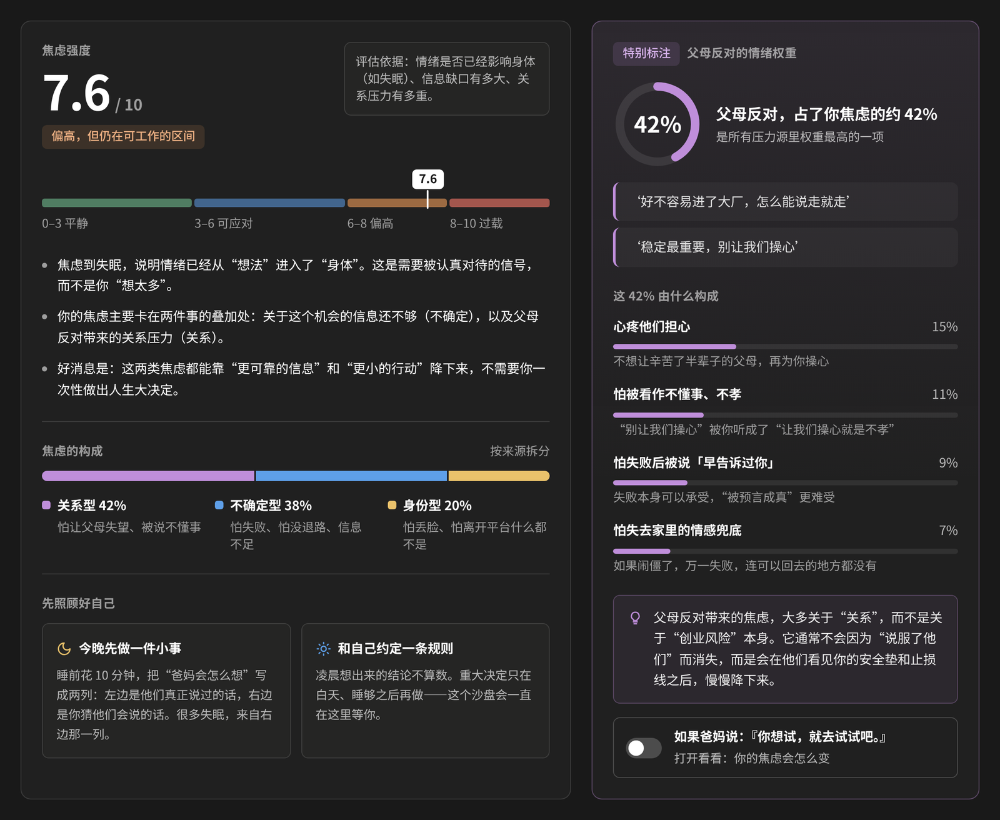

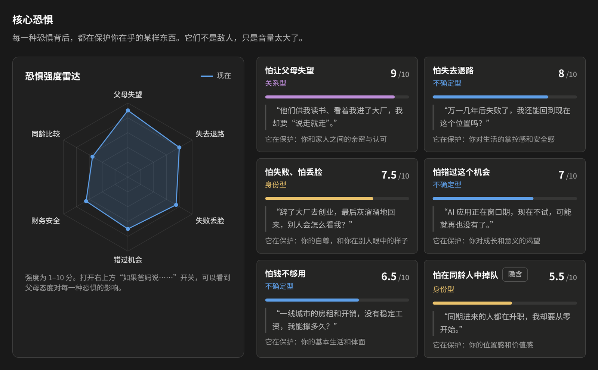

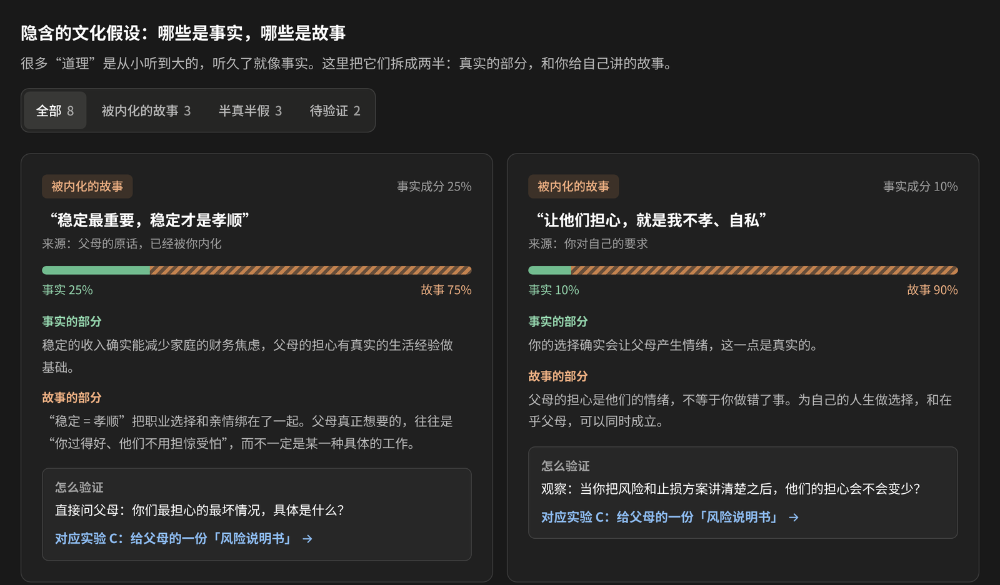

### 3. 三条平行路径

保守留任、谨慎试水、阶段性投入。每条路径都包含：

- 六项指标：可行性、焦虑指数、家庭摩擦、财务风险、成长空间、可逆性
- 未来 3 年的压力与情绪曲线，以及曲线上的关键节点
- 1 年后、3 年后大概的样子，主要风险和可能的后悔点
- 最容易被什么击穿，以及怎么提前加固

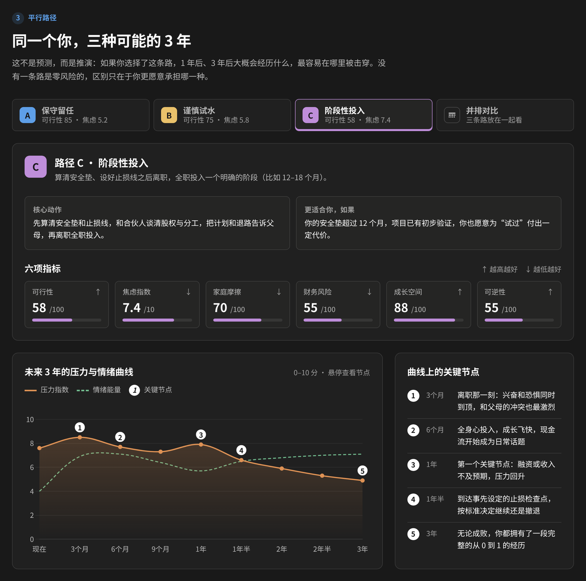

切到「并排对比」，三条曲线放在同一条时间轴上，并附一张六项指标对比表（绿色为该项最优）。

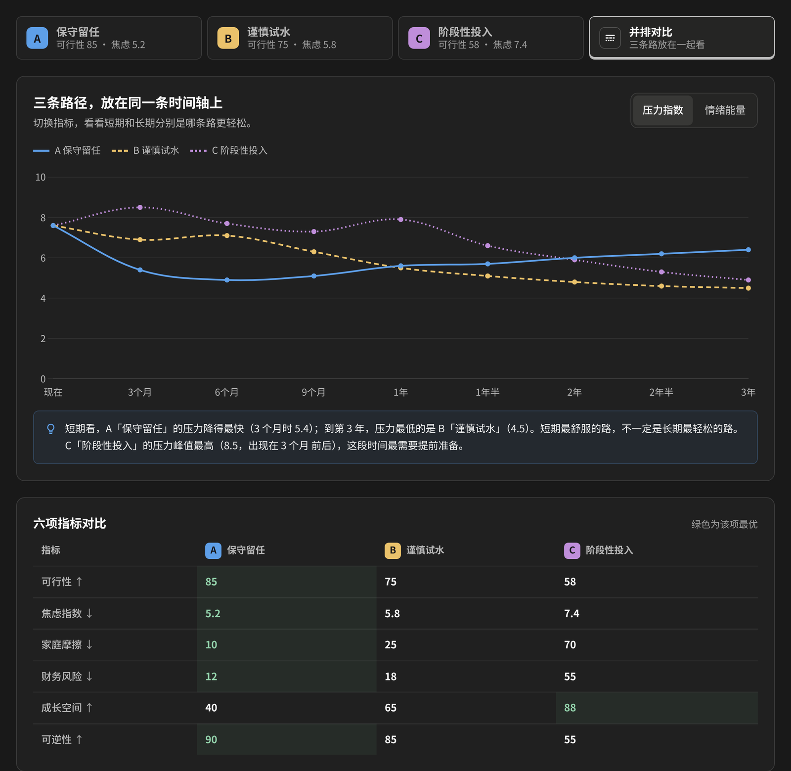

### 4. 最小实验

先别急着决定。3 个 7–14 天的实验，每个只回答一个具体问题：要验证哪些假设、每天做什么、做完能知道什么、时间 / 金钱 / 情感成本、对父母的影响和风险等级。点「我准备做这个实验」加入计划，顶部会汇总周期、总投入和花费。

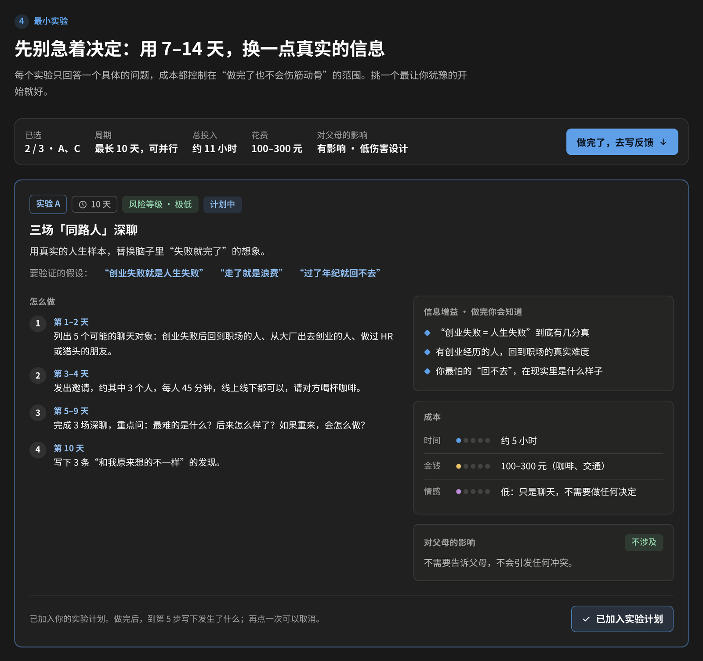

实验 C 里内置「安全垫计算器」：输入存款、每月支出、辞职后收入和计划投入，算出大约能撑几个月，还能一键写进反馈。数字只在本页计算，不会上传。

<p align="center">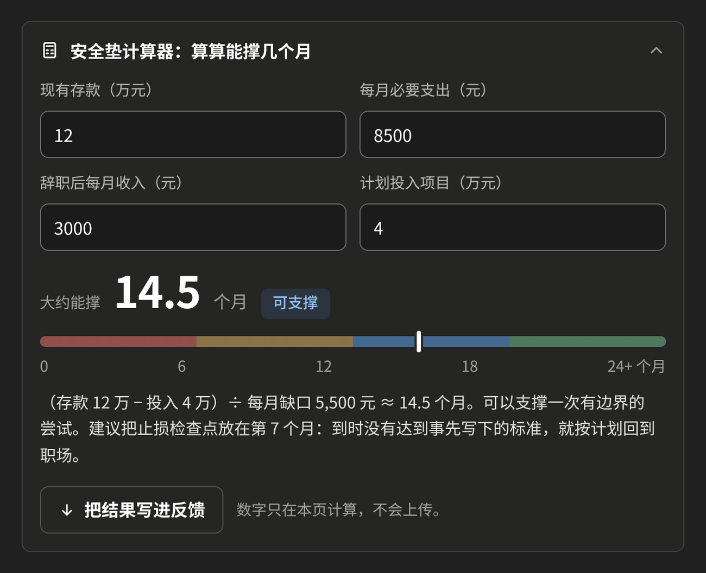</p>

### 5. 反馈更新

做完实验，写下发生了什么和你的感受，点「更新沙盘」。沙盘会重新评估三条路径的可行性与焦虑，说明父母反对的权重怎么变了、哪些假设被证实或证伪，并给出下一步建议；每次更新都会记录一个版本（v1 → v2 → …）。

还没做实验？可以先用「比预想的好 / 喜忧参半 / 比预想的难」三段示例反馈试一试。

<table>
  <tr>
    <td width="50%" valign="top">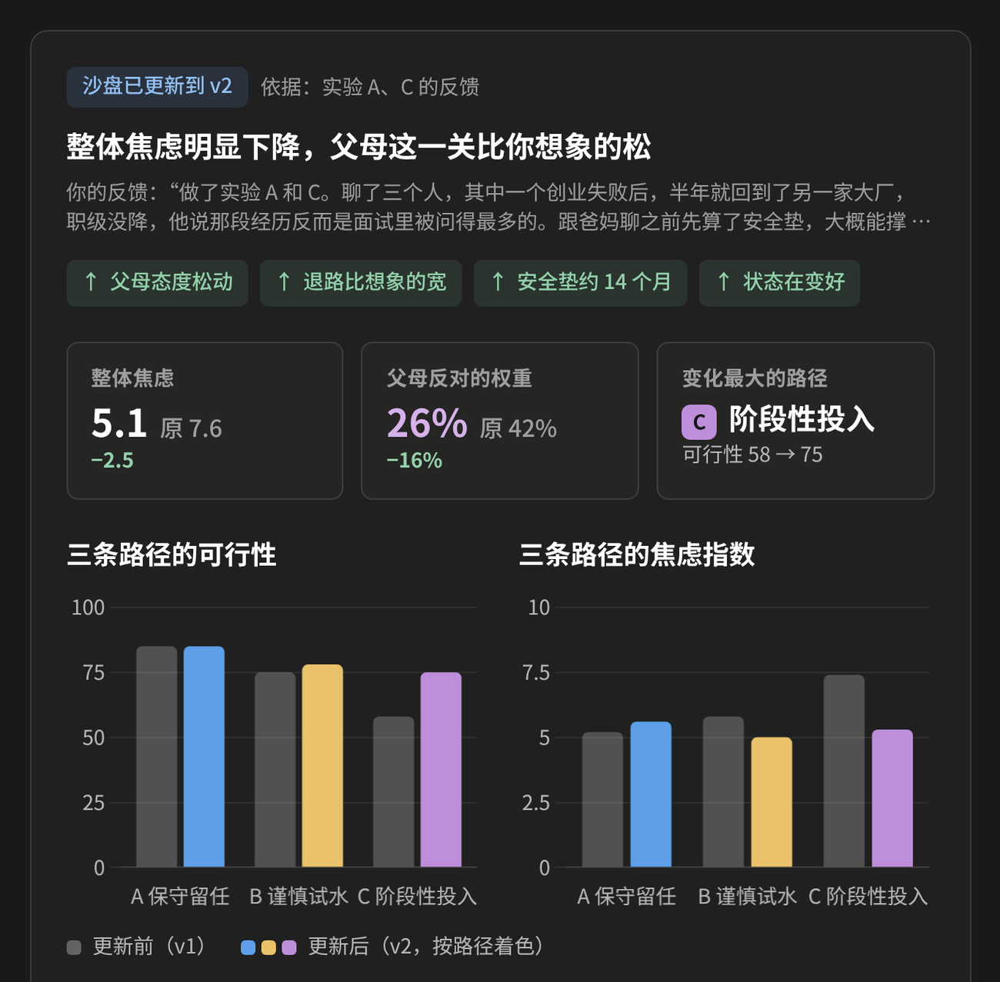</td>
    <td width="50%" valign="top">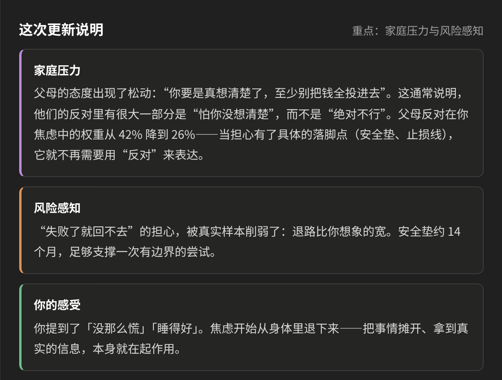</td>
  </tr>
</table>

### 手机上也能用

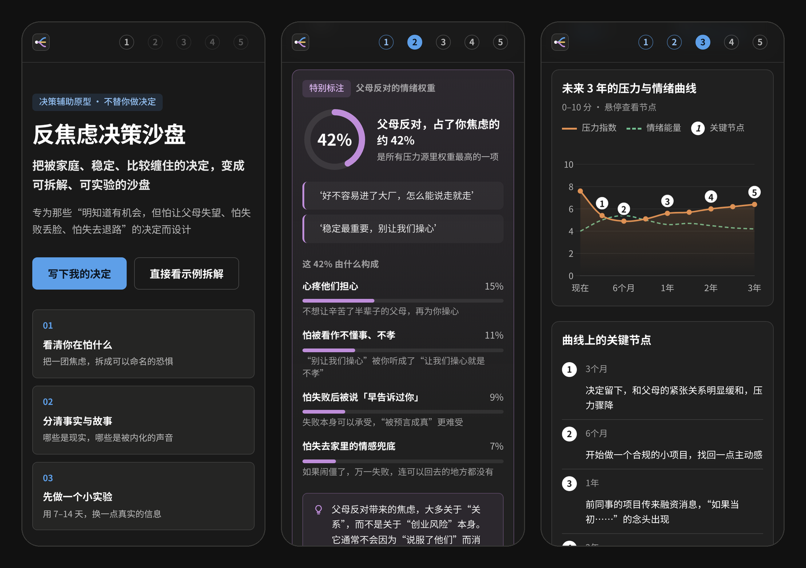

## 使用方式

- **在线**：直接打开 https://fuzzylogic112.github.io/anti-anxiety-sandbox/
- **本地**：下载仓库里的 `index.html`，双击用浏览器打开即可
- 需要联网加载 Tailwind CSS 与 Chart.js。页面内置了多个 CDN 地址（含国内镜像），一个连不上会自动换下一个

## 接入大模型

当前版本用内置示例数据和透明的本地规则来模拟模型，方便直接体验。接入真实模型只需替换 `index.html` 里的两个函数，界面代码不用改：

| 函数 | 作用 | 输入 | 输出 |
| --- | --- | --- | --- |
| `analyzeDecision(text)` | 拆解一个决定 | 用户写下的原文 | 与 `MOCK_ANALYSIS` 同结构的 JSON（焦虑、恐惧、假设、三条路径、实验……） |
| `reassessSandbox(prev, fb)` | 根据反馈重新评估 | 当前快照，以及 `{ text, exps }`（反馈原文与对应的实验） | 更新报告：新快照 `after`、各路径的变化原因、家庭压力与风险感知说明、下一步建议 |

```js
// 示例：把拆解交给你自己的后端或大模型 API
async function analyzeDecision(text) {
  const res = await fetch('/api/analyze', {
    method: 'POST',
    headers: { 'Content-Type': 'application/json' },
    body: JSON.stringify({ text })
  });
  return await res.json(); // 字段结构与 MOCK_ANALYSIS 一致
}
```

`reassessSandbox` 目前是同步函数；换成调用模型的异步版本后，在 `runUpdate` 里把调用改成 `await reassessSandbox(...)` 即可。

## 技术与设计

- 单个 HTML 文件，无需构建，也没有后端
- Tailwind CSS 4（浏览器版）+ Chart.js 4
- 深色主题，手机、平板、电脑自适应
- 支持键盘操作，焦点清晰可见，并遵循系统的「减少动态效果」设置
- 代码按功能分区并附中文注释，示例数据集中在 `MOCK_ANALYSIS`，便于替换

## 隐私

页面不收集、不上传任何内容。你写下的文字和计算器里的数字，都只在你自己的浏览器里处理。

## 写在最后

这是一个帮助梳理决定的工具，不是心理诊断或治疗。如果失眠、心慌已经持续两周以上，影响到吃饭、工作或日常生活，比起再做一次分析，更值得先照顾好自己：和信任的人聊聊，或者寻求专业心理咨询的帮助。

> 这个沙盘不替你做决定，它只是帮你把“怕让父母失望”和“怕错过机会”这些缠在一起的情绪，拆开看清楚。
